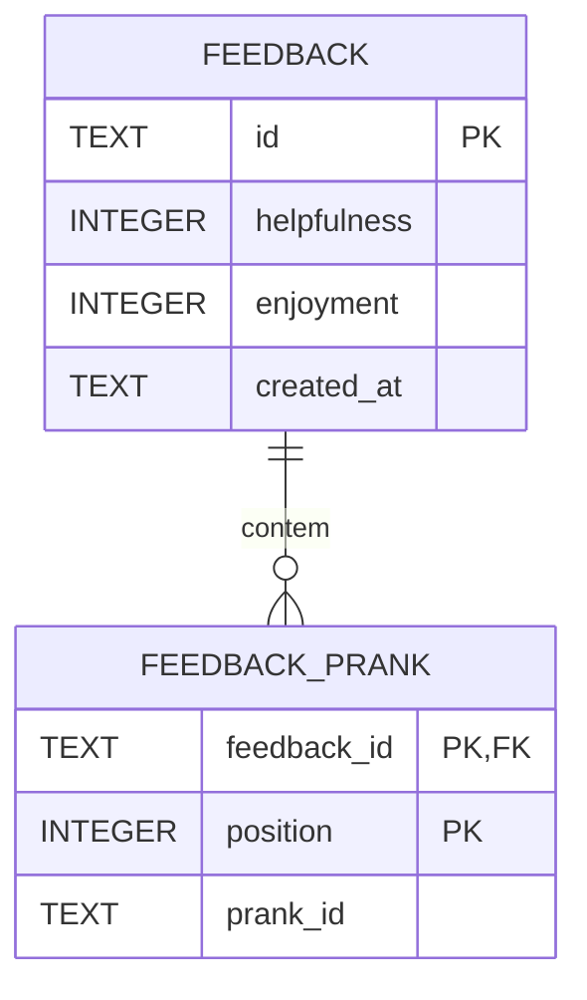

# Banco de avaliações locais

## Decisão e finalidade

O Projeto A3 exige banco integrado. O EquipIAda usa SQLite em arquivo para avaliações voluntárias de utilidade da resposta e diversão da interação. Essa função permite observar a proposta do produto, com persistência real e sem adicionar histórico de conversa, contas ou um servidor externo de banco.

O banco não recebe perguntas, respostas, nomes, e-mails ou comentários livres. A API aceita apenas identificador aleatório da avaliação, duas notas de 1 a 3 e até quatro IDs de cenas. Campos extras são rejeitados. Uma leitura pode criar o arquivo vazio, mas nenhum registro é inserido antes de Salvar avaliação.

## Preparação e operação

Requer Node.js 22.13 ou superior, por usar `node:sqlite`; validado com Node 24.22.1. O driver síncrono atende ao pequeno volume da demonstração local. Não é uma arquitetura de serviço público de alto volume.

```bash
npm ci
npm run db:init
```

`EQUIPIADA_DATABASE_PATH` é opcional. O padrão é `data/equipiada.sqlite`, relativo à pasta do projeto. Copie `.env.example` para `.env.local` e ajuste o caminho somente se necessário. A migração também é aplicada automaticamente na primeira operação da aplicação. Reexecutar `db:init` não apaga avaliações nem duplica tabelas; imprime apenas o caminho e o resumo agregado.

O arquivo SQLite e seus arquivos auxiliares ficam ignorados pelo Git. A migração `database/migrations/001_feedback.sql` é versionada e recria a estrutura vazia; não há dados iniciais nem senha obrigatórios. Para cópia de segurança, encerre a aplicação e copie o arquivo. Não há comando de limpeza destrutiva automático.

## Modelo relacional



`feedback` guarda duas notas (1 negativa, 2 intermediária/neutra, 3 positiva) e a data de criação. `feedback_prank` preserva a ordem de zero a três das cenas dessa avaliação. A chave estrangeira aponta para `feedback`; há unicidade por posição e por cena, limites de notas e catálogo permitido. As tabelas usam `STRICT`. Uma resposta obtida por Pular pode ter zero cenas.

## Caminho da integração

1. `FeedbackPanel` aparece após uma resposta válida. A pessoa escolhe as duas notas e confirma o envio; a avaliação é opcional.
2. `POST /api/feedback` limita corpo a 2 KB, valida tipo JSON e o contrato fechado e limita gravações a 60 por hora por origem durante o uso local.
3. `FeedbackRepository` abre o arquivo, aplica a migração de versão 1 quando necessário e usa parâmetros SQL em todas as entradas.
4. Uma transação grava a avaliação e suas cenas. Repetir o mesmo UUID não duplica: atualiza as notas e substitui as cenas da mesma avaliação. UUIDs são normalizados para minúsculas.
5. `GET /api/feedback` lê apenas total e médias. Não há endpoint que exponha perguntas, respostas ou uma lista de avaliações individuais.
6. Falha de gravação devolve erro recuperável; o texto da resposta e as escolhas no formulário continuam disponíveis.

O repositório é uma classe que encapsula o acesso ao SQLite. O componente React e as regras do Diretor de Caos não executam SQL. Essa separação é uma decisão efetivamente usada no código, não uma afirmação de que esse padrão foi estudado pela turma.

## Reprodução de testes

`tests/feedbackRepository.test.mjs` usa arquivos SQLite temporários reais: migração e reabertura, relacionamento, repetição/atualização sem duplicação, erro simulado por trigger com rollback e integridade referencial. `tests/feedback.test.mjs` verifica o contrato e a rejeição de campos privados. `tests/browser/feedback.spec.ts` percorre formulário, API e arquivo SQLite, inclusive erro e nova tentativa.

O Playwright usa porta 3100, saída `.next-test` e `data/test-feedback-<processo>.sqlite`, sem misturar notas sintéticas com avaliações reais em `data/equipiada.sqlite`. Os arquivos temporários são ignorados pelo Git e não representam testes com colegas.

## Limites

Não há autenticação nem isolamento entre usuários de um computador; o destino é uma demonstração local. A limitação por origem é em memória. A primeira versão usa acesso síncrono e uma migração única; novas versões devem acrescentar migrações e testes, sem apagar silenciosamente bancos existentes. Persistência de notas não verifica a correção factual do Ollama.
